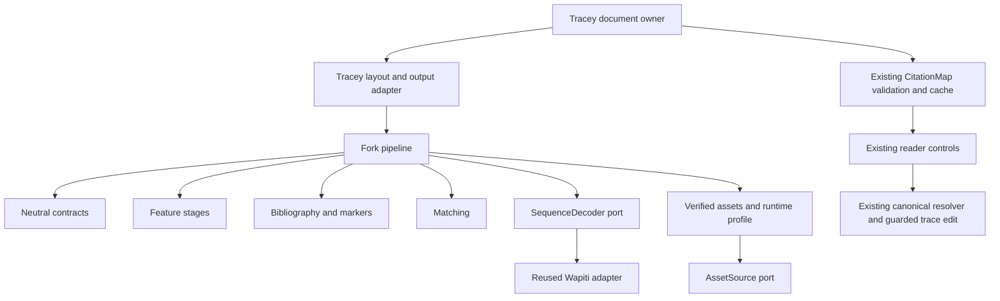

# GROBID-fork architecture specification

Version: 0.1. Date: 13 October 2026.
Status: planned architecture; production code is not present.

## Authority and boundaries

The [activity specification](SPECIFICATION.md) controls behavior.
The [API specification](API_SPECIFICATION.md) defines the public contracts.
The [framework API](FRAMEWORK_API_SPECIFICATION.md) defines experimental stages, composition, execution and scoring.
The [compatibility review](MODEL_COMPATIBILITY.md) identifies required reuse checks.

Keep upstream source and assets in their current locations.
Put all new fork implementation files under `tracey/`.
Use one small Rust crate with modules for distinct responsibilities.
Add another crate only when a verified platform boundary requires it.
Folder names alone do not establish SOLID compliance.

## Planned folder structure

Only the documents and contract records exist in this specification phase.
The runtime and tool paths below are planned locations.

```text
tracey/
  README.md
  docs/
    SPECIFICATION.md
    ARCHITECTURE_SPECIFICATION.md
    API_SPECIFICATION.md
    MODEL_COMPATIBILITY.md
  contracts/
    model-profile.json
    evaluation.json
  crates/
    grobid-fork/
      Cargo.toml
      src/
        lib.rs
        contract/        # Validated neutral input and output types
        layout/          # Layout admission and source spans
        assets/          # Manifest and content checks
        profile/         # Complete runtime identity
        features/        # Required upstream-compatible feature stages
        inference/       # Decoder port and Wapiti adapter
        bibliography/    # Reference, name and date result assembly
        markers/         # Body marker result assembly
        matching/        # Required upstream matching rules
        pipeline/        # Stage order, bounds and cancellation
  native/
    wapiti/              # Verified source build and minimal portability changes
  pipeline/
    stages/              # Thin experiment adapters for supported operations
    definitions/         # Named ordered compositions
  experiments/           # Pinned inputs, trial schedules and run conditions
  evaluation/
    runner/              # One experiment execution owner
    datasets/            # Candidate inputs and separate reference answers
    metrics/             # Compatible task scoring and stage comparisons
    reporting/           # Raw evidence, counts and comparison reports
  tests/
    contracts/
    features/
    inference/
    matching/
    geometry/
    integration/
```

Keep source archives, model caches, corpus downloads and generated reports outside this tree.
The `native/wapiti` folder must identify reused source and retained notices.
Do not copy an unverified operating-system binary into a different target package.

The existing Tracey build and asset owners must package model delivery.
Cloudflare currently limits each static asset file to 25 MiB.
Several unchanged model files exceed that limit.

Use ordered, immutable transport chunks with content digests where required.
Check the complete reconstructed asset against its original model digest before inference.
Chunking must not change parameters, feature templates or the decoder's model bytes.
Keep transport and cache code outside the pure pipeline.

Source: [Cloudflare static asset limits](https://developers.cloudflare.com/workers/platform/limits/#account-plan-limits).

## Dependency direction



The fork must not depend on `tracey-core`, `tracey-app` or `tracey-documents`.
Tracey's document crate may depend on the fork crate.
Evaluation may call both implementations. Production must not depend on evaluation or the upstream Java service.

## Responsibility partition

| Owner | Input | Output | Changes when |
| --- | --- | --- | --- |
| Contract | Raw neutral records | Validated layout and mapping types | An interface invariant changes |
| Layout | Admitted layout records | Ordered source tokens and frames | Layout validation changes |
| Assets | Manifest and bounded byte source | Verified model and resource handles | An asset or verification rule changes |
| Profile | Verified dependencies and algorithms | Runtime profile digest | Processing identity changes |
| Features | Layout and verified lexicons | Ordered model feature sequences | An upstream feature rule changes |
| Inference | Features and verified model | Labels aligned with input | Decoder or target support changes |
| Bibliography | Reference, name and date labels | Neutral reference records | Reference assembly changes |
| Markers | Body labels and source spans | Marker occurrences | Marker assembly changes |
| Matching | Markers and references | Linked, unresolved or ambiguous decisions | Upstream matching rules change |
| Pipeline | Validated input, ports and policy | Complete mapping or explicit failure | Stage order or run policy changes |
| Tracey document adapter | Existing PDF and fork output | Existing CitationMap | Host representation changes |
| Tracey application | Explicit citation selection | Existing personal trace edit | Product behavior changes |
| Evaluation | Fixed inputs and both outputs | Reproducible evidence | Scoring or reporting changes |

No owner may also implement another owner's cache, catalogue identity or personal storage.
Experiment adapters must use the framework contracts. They must not export every private model implementation.
The experiment runner must not contain feature, matching or scoring rules.
Reference answers must reach scoring through a separate input.
Features must not load models. Matching must not request catalogue data.
Inference must not select papers. The pipeline must not know the active trace.

## SOLID rules

### Single responsibility

Each module must own one reason to change from the responsibility table.
Split a module when independent platform and domain changes become coupled.
Do not split trivial functions into separate modules without a boundary purpose.

### Open and closed boundaries

Support a verified decoder or asset source through its existing port.
Do not add target-specific branches to feature or matching rules.
A changed model family must use a different explicit profile.

### Substitution

Every decoder must meet the same sequence, label, failure and cancellation contract.
Successful construction must establish capability for the requested model profile.
An unavailable target must report failure. It must not return empty successful labels.

### Interface separation

Expose only asset reads, sequence decoding, decoder identity and cancellation through the ports.
Keep training, file discovery, network access and application actions out of those ports.
Keep feature construction and matching stages private unless a real verification boundary requires access.

### Dependency inversion

The pipeline must consume validated contracts and narrow ports.
The host must supply PDF layout, verified asset access and lifetime control.
Native and WebAssembly adapters must contain only required platform differences.

## Existing code to retain

Retain upstream model bytes, feature definitions, tokenization rules, lexical resources and matching semantics.
First test established Wapiti inference. Port only required adapter code or incompatible source operations.
The [compatibility review](MODEL_COMPATIBILITY.md) records the reuse decision for each component.

Retain these Tracey owners:

- The existing PDFium document, receipt, admission and page transform.
- The existing citation-map validation and disposable document cache.
- The existing DOI and arXiv normalization and canonical catalogue resolver.
- The existing reader gestures, Find, lens and save-before-transition controller.
- The existing trace inclusion, personal ideas, notes, revisions and guarded writes.

The production adapter must not emit TEI and parse it again solely to connect two local Rust modules.
Use the neutral typed output and one documents-owned adapter.
Retain TEI parsing for baseline comparison and legacy test evidence.

## Processing and publication

1. Capture the admitted document identity and host generation.
2. Obtain layout through the existing PDF owner.
3. Validate layout, limits and the verified processing profile.
4. Run required feature, inference and matching stages.
5. Validate the complete neutral output.
6. Adapt the output through the existing document owner.
7. Recheck identity and generation before publishing controls.

The pipeline must return no personal graph edits.
The application must capture the trace revision for an explicit reference selection.
It must recheck trace and document identity before committing the canonical target.

Rendering must not hold its serial queue during a complete machine learning pass.
The host must use bounded chunks, yields or a separate inference lifetime.
It must not create another PDF engine for that purpose.
For non-cooperative inference, termination must invalidate the result and release the worker or native processing context.

## Profiles and saved evidence

The runtime profile must identify all model inputs and inference behavior.
The parent map profile must also identify PDF extraction, output adaptation and the map schema.
One documents-owned identity function must serve native and browser caches.
Changing any input must produce a different profile and inactive old controls.

New saved occurrence keys must include the complete map profile and document digest.
Legacy parser-order keys remain historical evidence. Do not reinterpret them through a new map.
The existing personal format can retain the new bounded string keys.
No additional graph collection or research mode is required.

## Implementation order and review gates

1. Verify source identities, resource closure and target inference support.
2. Compare labels with saved upstream feature inputs.
3. Compare feature vectors with identical upstream layout inputs.
4. Compare reference assembly and marker matching with upstream fixtures.
5. Add the existing PDFium layout adapter and run gold evaluation.
6. Check original-page geometry, resource use and cancellation on target devices.
7. Connect the existing map adapter and verify the complete reader journey.

Each step must retain its inputs, failures and evidence.
Do not bypass a failed compatibility gate with a new heuristic.
First identify whether the difference comes from extraction, features, inference or matching.
Record the smallest justified change and repeat the affected downstream checks.
